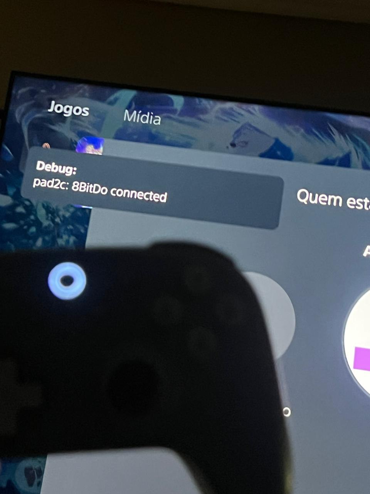
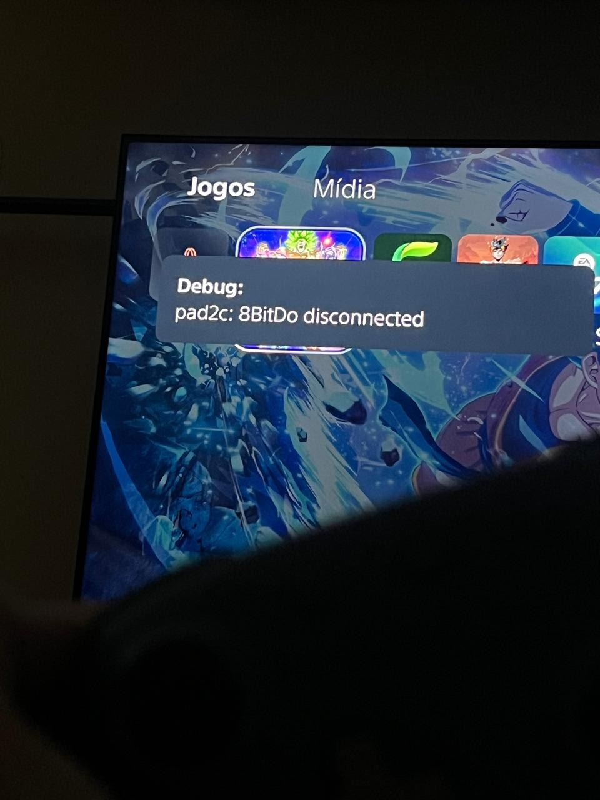

# pad2c

**Use an [8BitDo Ultimate 2C Wireless Controller](https://www.8bitdo.com/ultimate-2c-wireless-controller/), or
almost any Bluetooth controller through the [8BitDo USB Wireless Adapter 2](https://www.8bitdo.com/usb-wireless-adapter-2/),
on a jailbroken PS5, next to your DualSense.**

pad2c is a payload for a jailbroken PS5. It reads the 8BitDo 2.4G dongle or the 8BitDo USB Wireless Adapter 2
plugged into the console's USB port and shows each controller to the system and to games as a **virtual
DualSense**, up to four at once. The console's Bluetooth is not involved, so it never touches your DualSense's
pairing. A settings page, opened from a phone or a computer, shows the controllers live.

## Screenshots

Switching the 8BitDo on and off, with pad2c running on the console:

<p align="center">
  
  &nbsp;
  
</p>
<p align="center"><em>Left: switched on; the console asks who is using the controller. Right: switched off.</em></p>

## Which controller

| Controller | Supported |
|---|---|
| [8BitDo Ultimate 2C **Wireless** Controller](https://www.8bitdo.com/ultimate-2c-wireless-controller/) (the one sold for PC / Android, with a 2.4G USB dongle), through its dongle | ✅ |
| 8BitDo Ultimate 2C **Bluetooth** Controller (the Switch edition, no dongle) | ❌ different product |
| The Ultimate 2C Wireless over Bluetooth, without the dongle | ❌ not yet |
| [8BitDo USB Wireless Adapter 2](https://www.8bitdo.com/usb-wireless-adapter-2/), with any controller it pairs with | ✅ tested with a DualSense, the Ultimate 2C (Switch mode) and a GameSir G8 Plus Galileo (Switch mode, with "Nintendo layout") |
| Wired XInput (Xbox 360) controllers on a USB cable | ✅ tested with a GameSir G8 Plus Galileo |
| Other 8BitDo 2.4G dongles | untested: run `pad2c-probe.elf` and open an issue with its output |

## Why this controller, and why the dongle

**The controller** is simply the one I own: pad2c was made to play with it on my PS5, next to the DualSense. It is
also a cheap way to get a second controller: a DualSense costs at least twice as much as the Ultimate 2C Wireless,
which still has Hall effect sticks and triggers.

**The dongle instead of Bluetooth**, on purpose:

- **No conflicts.** The PS5 has one Bluetooth chip, and the system uses it for the DualSense. Sharing it from a
  payload risks taking over or unpairing the DualSense, and the chip is laid out differently from one console model
  to another. The dongle is a plain USB device: pad2c never touches the console's Bluetooth.
- **Simpler.** No pairing, no Bluetooth stack to keep alive, no reconnection logic: the dongle and the controller
  already talk to each other, and pad2c only reads what the dongle sends.
- **Practical.** Plug the dongle into a USB port and switch the controller on. That is all.

## FAQ

**Can I use an 8BitDo controller on a PS5?** Not on a stock PS5: it only accepts its own and a few licensed
controllers. On a jailbroken PS5, pad2c makes the 8BitDo Ultimate 2C appear as a DualSense.

**Does it work in games, or only in the menus?** In games too. Give the controller its own console user (the console
asks when you press Home) and it is player 2, like a second DualSense.

**Do I lose my DualSense?** No. Both work at the same time. pad2c does not use the console's Bluetooth at all.

**Can I use my DualSense, an Xbox or a Switch Pro controller through the adapter?** Yes: the USB Wireless Adapter 2
pairs with them over its own Bluetooth, and pad2c reads the adapter. Pairing a DualSense with the adapter unpairs it
from the console; plug it into the console with its cable and press PS to pair it back.

**A/B and X/Y are swapped on my controller.** Some controllers in Switch mode send the Nintendo layout (A on the
right). Tick **Nintendo layout** for it on the settings page.

**Which firmware?** Tested on 13.60 (PS5 Slim). It needs a console that already runs a payload loader such as elfldr
or Payload Manager; it does not jailbreak anything itself.

## Status

| | |
|---|---|
| Tested on | PS5 Slim (CFI-2114), firmware **13.60**, elfldr 0.26, kstuff-lite 1.11, Payload Manager 0.5.2 |
| Controllers | 8BitDo Ultimate 2C Wireless, 2.4G dongle, DInput (`2dc8:301c`) and XInput (`2dc8:310a`) modes; 8BitDo USB Wireless Adapter 2, firmware 1.10, XInput (`2dc8:3106`) and DInput (`2dc8:3105`) modes |
| Works | all buttons, sticks, analog triggers, d-pad, Home = PS, console menus and games, sleep and wake, the console's "who is using this controller" screen, remembers its user, "turn off" from the console's menu, up to four controllers at once |
| Not yet | vibration, light bar, motion sensors, audio |

Other firmwares and console models are untested.

The controller has two modes on its dongle, both work. It keeps the one last chosen:

- **DInput** (the default): with the controller on, hold **B + Home** until it switches off, then **B + Home** again
  until it switches on.
- **XInput** (seen by a PC as an Xbox controller): the same with **X + Home**. L4/R4 send nothing in this mode.

### The 8BitDo USB Wireless Adapter 2

Plug it in and switch the controller on: nothing to set. The adapter picks its mode from the host it sees; pad2c
answers it as Windows does, so it settles in **XInput** by itself, and pad2c hides the keyboard and mouse the adapter
adds in that mode, so the console lists only the controller.

**DInput** works too and also passes a DualSense's touchpad click: with the controller connected, hold **View
(Create on a DualSense) + Left** for 3 seconds (the adapter's light blinks twice). To let the adapter choose by itself
again, hold its button until its light goes off, then pair the controller again. Its DualShock 4 mode does not work
(it stops sending after a moment); pad2c's answer keeps it from ending there.

Notes:

- The 8BitDo has no touchpad: its extra **L4 / R4** buttons press the touchpad.
- "Turn off" in the console's menu disconnects the controller from the console, as with a DualSense, and Home
  connects it again. The 8BitDo itself stays on until it goes to sleep by itself (the dongle's commands to switch
  it off are not known).
- Vibration: PS5 games send DualSense haptics as audio to the controller, and a virtual DualSense has no known way
  to receive them yet.

## Button map

| 8BitDo | DualSense |
|---|---|
| A / B / X / Y | ✕ / ○ / □ / △ (by position) |
| LB / RB / LT / RT | L1 / R1 / L2 / R2 (analog) |
| View / Menu | Create / Options |
| Home | PS |
| L3 / R3 | L3 / R3 |
| L4 / R4 | touchpad click |

## Install

1. Plug the dongle (or the USB Wireless Adapter 2) into a USB port of the PS5 and switch the controller on.
2. Send `pad2c-<version>.elf` to your payload loader (elfldr listens on port 9021), or add it to Payload Manager
   and to its autoload list, so that it starts with the console.
3. A notification says it is running, with the address of the settings page. Press **Home** on the controller: the
   console asks who is using it.
   For a second player, pick a **second user** (a game takes one controller per user). pad2c remembers the choice
   and gives the controller back to that user next time, as a DualSense does.

Files, all in `/data/pad2c/`:

| File | |
|---|---|
| `pad2c.log` | the log |
| `stop` | create it to stop pad2c (it also stops by itself before rest mode) |
| `owner`, `owner.1`... | the user the controller in each slot was last given to (delete to forget) |
| `config` | the settings page's choices (`swap <controller name>` for Nintendo layout) |
| `bind_user` | optional: `main`, `other` or a hexadecimal user id, to give the controller to that user at once |

## Settings page

Open **http://&lt;console IP&gt;:8090** in a browser on the same network (the address is in the notification when
pad2c starts). For each controller: its name, mode, slot and user, the **Nintendo layout** switch (A/B and X/Y
swapped, applied at once and kept), and its buttons, sticks and triggers live, to check a mapping. The page is open
to the local network, without a password.

## How it works

- `src/usbpad.c` opens each pad's `/dev/ugenB.A` node and reads its interrupt IN endpoint, up to four pads, each its
  own virtual DualSense. The console's own HID driver holds the interface but ignores the device. New pads are
  looked for every 100 ms. The internal Bluetooth chip (`ugen0.2`) is never touched.
- The USB Wireless Adapter 2 shows several identities when plugged in (8BitDo XInput, Xbox 360, DualShock 4) and
  keeps the one whose host answers like Windows or a Switch. pad2c sends XInput pads what Windows sends first (the
  Microsoft OS string and the XUSB request, then the LED), and detaches the console's driver from a boot keyboard or
  mouse beside the pad.
- With no controller the dongle shows up as "8BitDo IDLE". When the controller connects, the dongle enumerates again:
  in DInput mode it sends HID report 1, turned into DualSense buttons by `src/map8bitdo.c`; in XInput mode it becomes
  `2dc8:310a` with an Xbox 360 interface, read by `src/mapxinput.c`. `src/usbdesc.c` picks the interface from the
  USB descriptor (XInput first, then the 8BitDo HID, never a keyboard). `make test` checks both against reports and
  descriptors captured on consoles. When the controller sleeps, the dongle enumerates again and the open device ends.
- `src/ps5_vpad.c` creates the virtual DualSense (`scePadVirtualDevice*`), finds its device id in the kernel log,
  gives it to a user (`sceMbusBindDeviceWithUserId`) and feeds it. It follows the kernel log while running: the
  console's choice of user is remembered, and its "turn off" (`sceMbusDisconnectDevice`) removes the virtual pad.
- `src/web.c` serves the settings page without blocking the pads; `src/config.c` keeps its choices.
- `src/probe.c` is a read-only diagnostic payload: it dumps the USB descriptors and the reports of whatever is
  plugged in. Useful to add support for another USB controller.

## Build

Needs [ps5-payload-sdk](https://github.com/ps5-payload-dev/sdk) and clang, lld and llvm. `tools/setup-wsl.sh`
(Linux or WSL) or `tools/setup-macos.sh` (Homebrew) installs them and writes `~/.ps5sdk`:

```
. ~/.ps5sdk
make test     # button maps, interface choice, settings, status JSON, on the PC
make          # dist/pad2c-<version>.elf and dist/pad2c-probe.elf
```

## Credits

- The virtual DualSense code (`ps5_vpad.c`) and the helpers `log.c`, `util.c`, `lock.c`, `ps5_power.c` and `pad.h`
  come from **AnyPad PS5** by **@elmonomalvad0** (sinfiltros), GPL-3.0-or-later, adapted here.
- [ps5-payload-sdk](https://github.com/ps5-payload-dev/sdk) by John Törnblom.

## Licence

GPL-3.0-or-later. See [LICENSE](LICENSE).

No Sony code, keys or firmware are part of this project. pad2c does not jailbreak anything: it needs a console
that already runs a payload loader.
