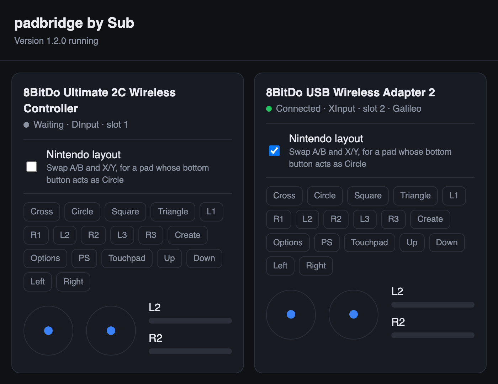

# padbridge

**Use controllers the PS5 does not accept, on a jailbroken PS5, as extra DualSense controllers.**

padbridge is a payload for a jailbroken PS5. It reads USB controllers and receivers plugged into the console and
shows each controller to the system and to games as a **virtual DualSense**, up to four at once, next to your own
DualSense:

- the **8BitDo Ultimate 2C Wireless** through its 2.4G dongle;
- almost **any Bluetooth controller** (DualSense, DualShock 4, Xbox, Switch Pro, 8BitDo, GameSir...) through the
  **8BitDo USB Wireless Adapter 2**;
- **wired XInput (Xbox 360) controllers** on a USB cable.

The console's own Bluetooth is never touched, so your DualSense stays paired. A **settings page**, opened from a
phone or a computer, shows each controller live and lets you fix controllers with the Nintendo button layout.

Up to 1.1.0 the project was called **pad2c**; see [Upgrading from pad2c](#upgrading-from-pad2c).

<p align="center">
  
</p>
<p align="center"><em>The settings page: the Ultimate 2C on its dongle, and a GameSir G8 through the USB Wireless
Adapter 2 with the Nintendo layout on.</em></p>

## Compatibility

Everything below was tested on a **PS5 Slim (CFI-2114), firmware 13.60**.

### Through the 8BitDo USB Wireless Adapter 2

[8BitDo USB Wireless Adapter 2](https://www.8bitdo.com/usb-wireless-adapter-2/), firmware 1.10. Plug it in, pair a
controller with it, switch the controller on: nothing to set on the adapter.

| Controller | How it pairs with the adapter | Result |
|---|---|---|
| DualSense | its normal pairing (Create + PS) | ✅ all buttons; vibration in XInput mode; touchpad click in DInput mode (View + Menu in XInput) |
| 8BitDo Ultimate 2C Wireless | Switch mode (Home + Y) | ✅ all buttons |
| GameSir G8 Plus Galileo | Switch mode (its only mode the adapter accepts) | ✅ with **Nintendo layout** on (it sends A/B and X/Y by label); **vibration** with the adapter in its Switch mode |
| Anything else the adapter accepts (DualShock 4, Xbox One / Series, Switch Pro, Joy-Con, Wii U Pro, 8BitDo) | | expected to work, untested: please report |

### 8BitDo Ultimate 2C Wireless on its own dongle

| Connection | Result |
|---|---|
| 2.4G dongle, DInput mode (`2dc8:301c`) | ✅ all buttons, L4/R4 as the touchpad click; no vibration (the controller only rumbles in XInput) |
| 2.4G dongle, XInput mode (`2dc8:310a`) | ✅ all buttons, **vibration** in PS4 games, View + Menu as the touchpad (the controller sends no L4/R4 in this mode) |
| USB cable (`2dc8:310a`, XInput) | ✅ as XInput mode above |

The 8BitDo Ultimate 2C **Bluetooth** Controller (the Switch edition, without a dongle) is a different product and is
not supported directly; it works through the USB Wireless Adapter 2.

The Ultimate 2C's **Star** and **Mapping** buttons never reach the console, in either mode: the controller keeps
them for its own turbo and mapping settings.

### Vibration

**PS4 games** rumble the controller (tested: Crash Bandicoot N. Sane Trilogy). padbridge reads what the game asks of
the virtual DualSense (`scePadVirtualDeviceGetRemoteSetting`: the large and small motors, as on a DualShock 4) and
sends it on:

| Controller | Rumbles |
|---|---|
| Ultimate 2C on its dongle | in XInput mode (tested) |
| Through the USB Wireless Adapter 2, Switch-type controllers (GameSir G8 tested, Switch Pro, Joy-Con) | with the adapter in its **Switch mode** (tested) |
| Through the USB Wireless Adapter 2, PlayStation controllers (DualSense tested) | in XInput mode |

**PS5 games do not rumble**: they send DualSense haptics, and the console turns even their classic rumble requests
into haptic audio before the virtual DualSense sees them. Controllers in DInput mode do not rumble either.

### Not yet

Vibration in PS5 games, light bar, motion sensors, audio.

## Install

1. Plug the dongle, the adapter or the controller's cable into a USB port of the PS5.
2. Send `padbridge-<version>.elf` to your payload loader (elfldr listens on port 9021), or add it to Payload
   Manager and to its autoload list, so that it starts with the console.
3. A notification says it is running, with the address of the settings page.
4. Switch the controller on and press **Home** (or PS): the console asks who is using it. For a second player, pick a
   **second user** (a game takes one controller per user). padbridge remembers the choice per controller and gives
   it back to that user next time, as a DualSense does.

It needs a console that already runs a payload loader; padbridge does not jailbreak anything itself.

## Settings page

Open **http://&lt;console IP&gt;:8090** in a browser on the same network (phone, computer, the console's own); the
address is in the notification when padbridge starts. For each controller:

- its name, mode (DInput or XInput), slot and the user it is given to;
- **Nintendo layout**: A/B and X/Y swapped, applied at once and kept, for controllers that send the Nintendo layout
  (A on the right), such as the GameSir G8 in Switch mode;
- its buttons, sticks and triggers, live, to check a mapping.

The page is open to the local network, without a password. Through the adapter, a setting belongs to the adapter:
it holds for whatever controller is paired with it.

## The 8BitDo USB Wireless Adapter 2

The adapter shows a different USB identity for each mode and picks its mode from the host it sees. padbridge answers
it as Windows does, so it settles in **XInput** by itself, and hides the keyboard and mouse the adapter adds in that
mode, so the console's Accessories list shows only the controller.

| Mode | How | Notes |
|---|---|---|
| XInput (`2dc8:3106`) | automatic | vibration in PS4 games for PlayStation controllers (DualSense tested); View + Menu as the touchpad |
| DInput (`2dc8:3105`) | hold **View + Left** (Create + Left on a DualSense) for 3 s; the light blinks twice | passes a DualSense's touchpad click |
| Switch (`057e:2009`, a Switch Pro Controller) | hold **- + L** (View + LB) for 3 s; the light blinks twice | **vibration for Switch-type controllers** (the adapter passes it on only in this mode); Capture as the touchpad; buttons by position, so a pad that sends them by label (GameSir G8) needs Nintendo layout |
| back to automatic | hold the adapter's button until its light goes off, then pair the controller again | |
| DualShock 4 (`054c:05c4`) | where it ends on a PS5 without padbridge's answer | does not work: it stops sending after a moment |

Pairing a DualSense with the adapter unpairs it from the console: plug it into the console with its cable and press
PS to pair it back. The adapter takes one controller at a time.

## The GameSir G8 Plus Galileo through the adapter

The G8's Bluetooth modes are Android, Switch and G-Touch; the USB Wireless Adapter 2 accepts only its **Switch**
mode. It then works in both of the adapter's modes, with two things to know:

| Adapter mode | Buttons | Vibration |
|---|---|---|
| **Switch** (hold **- + L** for 3 s) | tick **Nintendo layout** on the "Pro Controller" card of the settings page | ✅ (PS4 games) |
| XInput (automatic) | tick **Nintendo layout** on the "8BitDo USB Wireless Adapter 2" card | ❌ the adapter passes rumble in XInput to PlayStation controllers only |

- **Nintendo layout:** in Switch mode the G8 sends its buttons by their printed letter (its bottom button is "A",
  which a Switch reads as the right one), not by position. A genuine Switch Pro Controller needs no setting.
- **Weak rumble:** simple rumble motors like the G8's do not move below a certain strength, and the Switch format
  splits rumble into a low and a high band, of which such pads feel mostly the low one. In the Switch mode,
  padbridge sends the stronger motor to the low band and starts any rumble at about 40%, so a light request (Crash
  Bandicoot's spin asks 25%) is still felt.
- The setting is kept per card, so the G8 and a DualSense can share the adapter: the DualSense uses the adapter's
  XInput mode, without Nintendo layout.

## The Ultimate 2C's two dongle modes

The controller keeps the last mode chosen. With the controller on:

- **DInput** (the default): hold **B + Home** until it switches off, then **B + Home** again until it switches on.
- **XInput**: the same with **X + Home**.

## Button map

| Controller | DualSense |
|---|---|
| A / B / X / Y (Xbox layout) | ✕ / ○ / □ / △ (by position) |
| LB / RB / LT / RT | L1 / R1 / L2 / R2 (analog) |
| View / Menu (Back / Start, - / +) | Create / Options |
| Home / Guide | PS |
| L3 / R3 | L3 / R3 |
| Ultimate 2C L4 / R4 (DInput), DualSense touchpad (adapter, DInput) | touchpad click |
| View + Menu pressed together, on XInput controllers | touchpad click |
| Switch Pro (and the adapter's Switch mode): B / A / Y / X, L / R, ZL / ZR, - / +, Home, Capture | ✕ / ○ / □ / △ (by position), L1 / R1, L2 / R2, Create / Options, PS, touchpad click |

## Notes

- "Turn off" in the console's menu disconnects the controller from the console, as with a DualSense, and Home
  connects it again. The controller itself stays on until it goes to sleep by itself.
- Every notification reads "padbridge by Sub", then the controller, its mode and what happened.
- On XInput controllers, View or Menu pressed alone reaches the console 60 ms late: padbridge waits that long for
  the other one, so that View + Menu (the touchpad) does not open the Create menu on the way.

## Files

All in `/data/padbridge/` on the console:

| File | |
|---|---|
| `padbridge.log` | the log |
| `stop` | create it to stop padbridge (in rest mode it lets the controllers go and waits; it picks them up again when the console wakes) |
| `owner`, `owner.1`... | the user the controller in each slot was last given to (delete to forget) |
| `config` | the settings page's choices (`swap <controller name>` for Nintendo layout) |
| `bind_user` | optional: `main`, `other` or a hexadecimal user id, to give controllers to that user at once |

## Upgrading from pad2c

padbridge 1.2.0 is pad2c renamed. On its first start it asks a running pad2c to stop and moves `/data/pad2c` to
`/data/padbridge`, remembered users and settings included. Replace `pad2c-<version>.elf` with
`padbridge-<version>.elf` in Payload Manager's autoload list.

## FAQ

**Can I use a non-Sony controller on a PS5?** Not on a stock PS5: it only accepts its own and a few licensed
controllers. On a jailbroken PS5, padbridge makes them appear as DualSense controllers.

**Does it work in games, or only in the menus?** In games too. Give each controller its own console user (the console
asks when you press Home) and it is player 2, 3 or 4, like another DualSense.

**Do I lose my DualSense?** No. Both work at the same time; padbridge does not use the console's Bluetooth. (Pairing
the DualSense itself with the USB Wireless Adapter 2 is your choice; see above.)

**A/B and X/Y are swapped on my controller.** Tick **Nintendo layout** for it on the settings page.

**My controller does nothing.** `/data/padbridge/padbridge.log` lists every USB device plugged in that padbridge does
not read, with its id and name: a controller in another mode (Switch, DS4) shows up there.

**My controller is not listed.** Run `padbridge-probe.elf` with it plugged in and open an issue with
`/data/padbridge/probe.log` (the issue template says what to include).

## How it works

- `src/usbpad.c` opens each controller's `/dev/ugenB.A` node and reads its interrupt IN endpoint, up to four, each
  its own virtual DualSense. New devices are looked for every 100 ms. The console's own HID driver holds the
  interface but ignores the device. The internal Bluetooth chip (`ugen0.2`) is never touched.
- `src/usbdesc.c` picks the interface from the USB descriptor: XInput (`ff/5d/01`) from any vendor first, then an
  Switch Pro Controller (`057e:2009`), then an 8BitDo HID interface, never a keyboard. `src/map8bitdo.c` (8BitDo
  DInput report 1), `src/mapxinput.c` (Xbox 360 report) and `src/mapswitch.c` (Switch Pro report 0x30) turn the
  reports into DualSense buttons.
- A Switch Pro Controller gets the USB handshake (80 02, 80 03, 80 02, 80 04) and its subcommands (full reports,
  vibration, player light) at connection; without them it keeps enumerating again. Its rumble is HD Rumble, encoded
  as SDL does and sent again every 50 ms while on.
- Rumble: `scePadVirtualDeviceGetRemoteSetting` is read every 16 ms per virtual pad (motors at [3] and [4]).
- XInput devices get what Windows sends first (the Microsoft OS string and the XUSB vendor request, then the LED):
  the USB Wireless Adapter 2 keeps XInput when its host answers like that. A boot keyboard or mouse beside the pad is
  detached from the console's driver.
- When a controller sleeps or switches off, the dongle or adapter enumerates again ("IDLE") and the open device ends.
- `src/ps5_vpad.c` creates the virtual DualSense (`scePadVirtualDevice*`), finds its device id in the kernel log,
  gives it to a user (`sceMbusBindDeviceWithUserId`) and feeds it. It follows the kernel log while running: the
  console's choice of user is remembered, and its "turn off" (`sceMbusDisconnectDevice`) removes the virtual pad.
- `src/web.c` serves the settings page without ever blocking the controllers; `src/config.c` keeps its choices.
- `src/probe.c` is a read-only diagnostic payload: it dumps the USB descriptors, names and reports of whatever is
  plugged in. Useful to add support for another controller.

## Build

Needs [ps5-payload-sdk](https://github.com/ps5-payload-dev/sdk) and clang, lld and llvm. `tools/setup-wsl.sh`
(Linux or WSL) or `tools/setup-macos.sh` (Homebrew) installs them and writes `~/.ps5sdk`:

```
. ~/.ps5sdk
make test     # button maps, interface choice, settings, status JSON, on the PC
make          # dist/padbridge-<version>.elf and dist/padbridge-probe.elf
```

## Credits

- The virtual DualSense code (`ps5_vpad.c`) and the helpers `log.c`, `util.c`, `lock.c`, `ps5_power.c` and `pad.h`
  come from **AnyPad PS5** by **@elmonomalvad0** (sinfiltros), GPL-3.0-or-later, adapted here.
- [ps5-payload-sdk](https://github.com/ps5-payload-dev/sdk) by John Törnblom.
- The Switch Pro Controller's USB protocol and HD Rumble: [dekuNukem's Nintendo Switch reverse engineering
  notes](https://github.com/dekuNukem/Nintendo_Switch_Reverse_Engineering), and [SDL](https://github.com/libsdl-org/SDL)'s
  HIDAPI Switch driver, whose rumble tables `src/mapswitch.c` uses (zlib licence).
- [Control4Free](https://github.com/MoHadiShibli/Control4Free) (GPL-3.0), whose notes showed that
  `scePadVirtualDeviceGetRemoteSetting` returns what a game asks of a virtual pad.

## Licence

GPL-3.0-or-later. See [LICENSE](LICENSE).

No Sony code, keys or firmware are part of this project. padbridge does not jailbreak anything: it needs a console
that already runs a payload loader.
